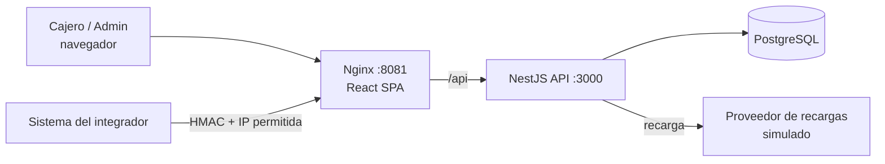
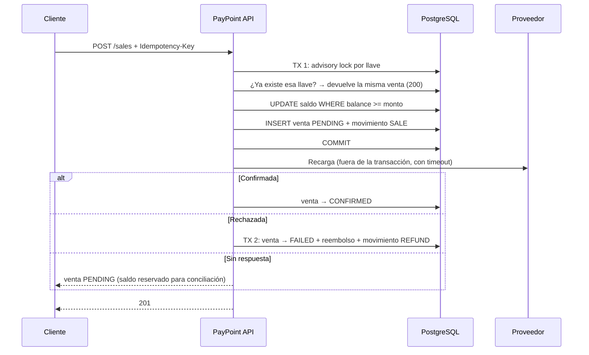

# PayPoint

[](https://github.com/vzuliani97/paypoint/actions/workflows/ci.yml)

Plataforma de recargas y pagos para una red de puntos de venta. Cada punto de venta tiene un saldo prepagado con el que vende recargas de celular y gift cards, ya sea desde un portal web o desde los sistemas de un integrador a través de una API B2B firmada.

*English: prepaid top-up and payments platform for a network of points of sale. NestJS + TypeScript + PostgreSQL API with an append-only balance ledger, idempotent sales that never overdraw under concurrency, automatic refunds, and a B2B API secured with HMAC-SHA256 request signing and IP allowlisting. React portal, Docker, 33 automated tests in CI.*

## Qué resuelve

| Problema | Cómo lo resuelve |
|---|---|
| Dos ventas simultáneas no pueden gastar el mismo saldo | Descuento atómico con `UPDATE ... WHERE balance >= monto` y `CHECK (balance >= 0)` |
| Un reintento por error de red no puede cobrar dos veces | `Idempotency-Key` obligatoria, `UNIQUE (pos_id, idempotency_key)` y un *advisory lock* por llave |
| El saldo siempre debe poder explicarse | Libro contable (`balance_movements`): cada crédito, venta y reembolso queda registrado |
| Si el operador rechaza la venta, el dinero vuelve | Reembolso automático, y la base de datos garantiza que ocurre una sola vez por venta |
| Si el operador no responde, no se sabe si cobró | La venta queda `PENDING` con el saldo reservado, en vez de reembolsar a ciegas |
| Solo integradores autorizados pueden vender por API | Firma HMAC-SHA256 del método, la ruta, el timestamp y el cuerpo, más lista blanca de IP |

## Stack

- **Backend:** NestJS 11, TypeScript, PostgreSQL 16 (driver `pg`, SQL explícito y migraciones versionadas), Zod, JWT, bcrypt, Helmet, métricas Prometheus (`/metrics`, solo interno)
- **Frontend:** React 19, TypeScript, Vite, servido con Nginx
- **Pruebas:** Jest y Supertest (10 unitarias y 23 de integración contra PostgreSQL real)
- **Infraestructura:** Docker multi-stage, Docker Compose, GitHub Actions

## Arquitectura



Módulos del backend: `auth` (JWT y roles), `pos` (puntos de venta, saldo y libro contable), `catalog` (productos), `sales` (flujo de venta y proveedor), `partner` (API B2B firmada) y `database` (pool, transacciones y migraciones).

## Flujo de una venta



La llamada al proveedor ocurre **fuera** de la transacción: mantener abierta una transacción con la fila del saldo bloqueada mientras se espera una respuesta de red frenaría todas las ventas del punto de venta.

## Ejecutar

```bash
cp .env.example .env      # y cambia los valores
make up                   # o: docker compose up --build
```

- Portal: http://localhost:8081
- Usuarios demo: `cajero@paypoint.local` y `admin@paypoint.local`, con la contraseña de `DEMO_PASSWORD`
- Integrador demo: `make partner-demo` consulta el saldo y hace una venta firmada

## Pruebas

```bash
make test                 # unitarias + integración en contenedores, con una base de datos desechable
```

O sin Docker para Node:

```bash
make test-db              # PostgreSQL temporal en el puerto 55432
cd backend && npm ci && npm test && npm run test:e2e
```

Escenarios cubiertos, entre otros:

- 10 ventas concurrentes con saldo para 6: exactamente 6 se aprueban y 4 reciben `INSUFFICIENT_BALANCE`.
- 5 reintentos simultáneos con la misma llave: una sola venta y un solo descuento.
- La misma llave con datos diferentes devuelve 409.
- Una venta rechazada por el proveedor se reembolsa una sola vez, y el libro contable cuadra.
- Si el proveedor no responde, la venta queda `PENDING` sin reembolso.
- Firma inválida, cuerpo alterado, timestamp vencido, llave desconocida o IP no permitida: todo se rechaza.
- Un cajero no puede acreditar saldo ni ver ventas de otro punto de venta.

En todas las pruebas de saldo se verifica la invariante **saldo = suma de los movimientos del libro contable**.

## API

| Método | Ruta | Acceso |
|---|---|---|
| POST | `/api/auth/login` | Público |
| GET | `/api/products` | JWT |
| POST | `/api/sales` | Cajero, `Idempotency-Key` |
| GET | `/api/sales`, `/api/sales/:id` | Cajero (su punto de venta) o admin |
| GET | `/api/pos/me`, `/api/pos/me/movements` | Cajero |
| GET, POST | `/api/pos`, `/api/pos/:id/credits`, `/api/pos/:id/movements` | Admin |
| GET | `/api/partner/v1/balance` | Integrador (HMAC) |
| POST | `/api/partner/v1/sales` | Integrador (HMAC), `Idempotency-Key` |
| GET | `/api/partner/v1/sales/:id` | Integrador (HMAC) |
| GET | `/health` | Público |

Todos los errores tienen el mismo formato:

```json
{ "error": { "code": "INSUFFICIENT_BALANCE", "message": "Not enough prepaid balance", "details": { "balance": 2000, "amount": 3000 } } }
```

### Firma de la API B2B

Cada petición del integrador lleva tres headers:

| Header | Valor |
|---|---|
| `X-Api-Key` | Identificador público del integrador |
| `X-Timestamp` | Segundos Unix; se rechaza si difiere más de 5 minutos del servidor |
| `X-Signature` | `hex(HMAC-SHA256(secreto, texto))` |

donde `texto` es:

```text
<timestamp>\n<MÉTODO>\n<ruta con query>\n<sha256 hex del cuerpo>
```

Al firmar el hash del cuerpo, cualquier cambio en el contenido invalida la firma. La comparación se hace en tiempo constante (`timingSafeEqual`). Una llave desconocida recibe la misma respuesta que una firma inválida. Después de la firma se valida la IP contra la lista del integrador (IPs exactas o rangos CIDR, IPv4 e IPv6). En `scripts/partner-client.mjs` hay un cliente de ejemplo.

## Seguridad

- Contraseñas con bcrypt. El login responde igual a un correo inexistente y a una contraseña incorrecta, y tarda lo mismo en ambos casos.
- JWT HS256 con algoritmo fijado al verificar y expiración de 1 hora. Roles verificados en cada ruta.
- Validación estricta con Zod (se rechazan campos extra) y body limitado a 10 KB.
- Restricciones `CHECK` y `UNIQUE` en la base de datos como última defensa.
- Nginx sobrescribe `X-Forwarded-For`, y la API confía en exactamente un proxy, así que un cliente no puede falsificar su IP.
- Backend y Nginx corren como usuarios sin privilegios, y la imagen del backend no incluye dependencias de desarrollo.

## Limitaciones y siguientes pasos

- **Conciliación de ventas `PENDING`:** un proceso periódico que consulte al proveedor y confirme o reembolse.
- **Secretos HMAC cifrados en reposo** (KMS o cifrado de columna); hoy se guardan en texto plano.
- **Idempotencia también en las acreditaciones de saldo** del administrador.
- Límite de intentos de login, refresh tokens y métricas (Prometheus).
- Los montos usan `INTEGER` en pesos; para otras monedas o montos muy altos se usaría `BIGINT` en unidades menores.
