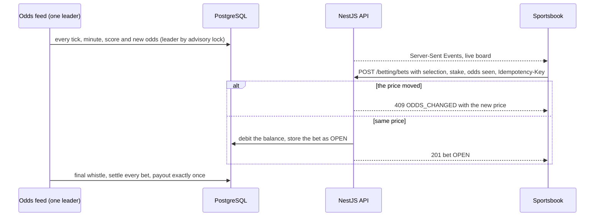
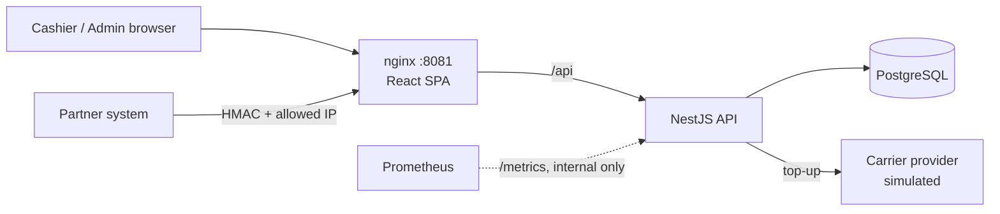
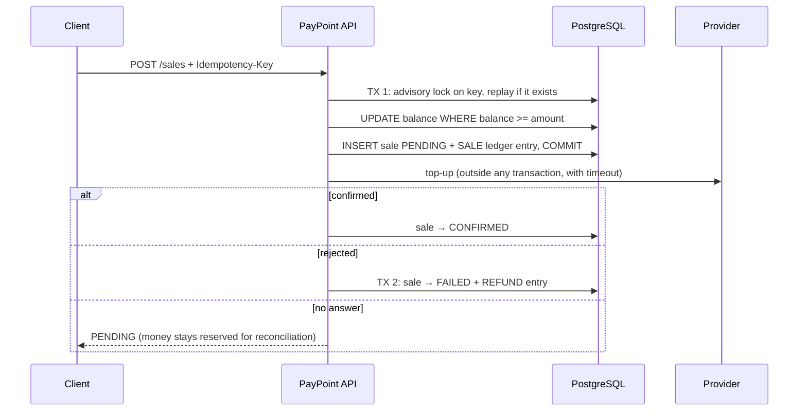

# AtomicTrail — Transaction Reliability Lab

*Formerly the PayPoint repository.*

[](https://github.com/vzuliani97/atomictrail/actions/workflows/ci.yml)
[](https://github.com/vzuliani97/atomictrail/actions/workflows/codeql.yml)

A TypeScript and PostgreSQL system that keeps balances correct under concurrent requests, retries, provider timeouts and reversals. It demonstrates idempotency, an append-only ledger, HMAC-signed integrations and real-time events.

A reliability lab for a transactional API: safe state transitions in PostgreSQL ("atomic") and an auditable record of every balance movement ("trail"). The sample service inside it is **PayPoint**, a prepaid top-up and payments platform for a network of points of sale. Each store holds a prepaid balance and sells mobile top-ups and gift cards, either from a web portal or from a partner's own system through a signed B2B API. The service's code, images and metrics keep the `paypoint` name.

The interesting part is not the CRUD. It is keeping money correct when requests race, retry or fail halfway.


## What it is for

A network of stores sells prepaid top-ups, live sports bets and casino play from one prepaid balance per store. Cashiers use a web portal; partner systems use a signed B2B API; providers (carrier, odds feed, game provider) answer late or not at all. The balance must stay right through all of it.

| Who | What they do here |
|---|---|
| Cashier | Sells top-ups, places live bets from the sportsbook (odds move in real time), opens casino games paid from the same balance, and sees every balance movement |
| Admin | Creates points of sale, credits balances, watches network sales |
| Partner system | Sells through the HMAC-signed API with its own idempotency keys |

## What I built

Everything in this repository, end to end:

- **Data model:** balances guarded by `CHECK (balance >= 0)`, an append-only ledger, sales, bets, settlements and casino wallet transactions, in plain versioned SQL.
- **API (NestJS):** idempotent sales with a per-key advisory lock and request hash, the provider call outside the transaction, refunds at most once, an HMAC-SHA256 partner API with an IP allowlist, JWT roles and Zod validation.
- **Live betting:** a simulated odds feed with a single leader (`pg_try_advisory_xact_lock`), Server-Sent Events to the browser, `ODDS_CHANGED` when the price moved, settlement paid exactly once.
- **Casino:** a seamless wallet whose provider callbacks are idempotent by transaction id, with rollback tombstones.
- **Frontend (React):** the cashier with top-ups, the sportsbook (leagues, live minute and score, 1X2 odds, bet slip, my bets) and the casino; the admin screens.
- **Delivery and quality:** Docker Compose, Prometheus metrics, multi-arch images published by CI and deployed by Argo CD in [OpsCircuit](https://github.com/vzuliani97/opscircuit), 48 automated tests, CodeQL, Gitleaks and `npm audit`.

| Problem | How PayPoint handles it | Proof |
|---|---|---|
| Two sales spend the same balance at once | Check and debit in one conditional `UPDATE`, plus `CHECK (balance >= 0)` | 70 concurrent sales against room for 50 approve exactly 50 ([local experiment](docs/concurrency-experiment.md), not a production benchmark) |
| A network retry charges twice | Mandatory `Idempotency-Key`, `UNIQUE (pos_id, key)`, a per-key advisory lock and a request hash | 70 concurrent retries create 1 sale; same key with a different body returns 409 |
| The balance can't be explained | Append-only ledger; tests check that the balance equals the sum of movements | Every balance test |
| The carrier rejects the top-up | Automatic refund, at most once per sale (enforced by a partial unique index) | Refund test |
| The carrier times out (outcome unknown) | Sale stays `PENDING` with the money reserved; never refunded blindly | Timeout test with a provider that never answers |
| Live odds move while the cashier decides | The bet carries the odds the cashier saw; if the price moved, the bet is refused with `ODDS_CHANGED` and no money moves | Odds-changed test |
| A match ends and winners must be paid | Settlement updates only `OPEN` bets and a unique index allows one payout per bet | Settling twice pays once |
| A casino provider retries or reverses a wallet call | Seamless wallet keyed by the provider's transaction id; a rollback that arrives before its debit leaves a tombstone | Retried debit applied once; late debit refused |
| Only authorized partners may sell | HMAC-SHA256 signature over timestamp, method, path and body hash; 5-minute window; IP allowlist with CIDR | Tampered body, stale timestamp, unknown key and wrong IP are all rejected |


## Processes, step by step

### 1. Sell a top-up

1. The cashier picks a product and the amount; the request carries an `Idempotency-Key`.
2. One conditional `UPDATE` checks and debits the balance, and the sale is committed as `PENDING` with the money reserved.
3. The carrier is called **outside** the transaction. Approved: `CONFIRMED`. Rejected: refunded at most once. No answer: it stays `PENDING`, never refunded blindly (see the [sale flow](#sale-flow)).


### 2. Place a live bet (simulated scenario)



1. The board shows live matches by league with minute, score and 1X2 odds that move up or down.
2. A tap on a price fills the bet slip; the bet carries the odds the cashier saw. If the price moved, the API refuses with `ODDS_CHANGED` and the slip offers the new one.
3. At the final whistle every bet is settled; a unique index guarantees one payout per bet.


### 3. Play the casino (simulated scenario, seamless wallet)

1. The game provider calls the wallet to debit a bet, credit a win or roll back, signing each callback with HMAC.
2. Every callback is idempotent by the provider's transaction id: a retry gets the same answer and moves no money twice.
3. A rollback that arrives before its debit leaves a tombstone, so the late debit is refused.


### 4. Partner API (B2B)

Partners sign timestamp, method, path and body hash with HMAC-SHA256; the server checks it in constant time within a 5-minute window and against an IP allowlist, then runs the same idempotent sale.

### 5. Administer the network

The admin creates points of sale, credits their balances and watches sales across the network.


## Stack

- **Backend:** NestJS 11, TypeScript, PostgreSQL 16 (plain SQL with the `pg` driver, versioned migrations), Zod, JWT, bcrypt, Helmet, Prometheus metrics
- **Frontend:** React 19 + TypeScript (Vite), served by unprivileged nginx
- **Real time:** Server-Sent Events for the live odds board, a simulated odds feed with one leader across replicas (PostgreSQL advisory lock)
- **Quality:** Jest + Supertest, 48 tests (10 unit, 38 integration against a real PostgreSQL), CodeQL, Gitleaks, `npm audit`, Dependabot
- **Delivery:** multi-stage Docker images running as non-root, Docker Compose, GitHub Actions publishing to GHCR. Deployed to Kubernetes in [OpsCircuit](https://github.com/vzuliani97/opscircuit).

## Simulated scenarios: live betting and casino

These are stress scenarios for the same guarantees, not the identity of the project. The same prepaid balance funds top-ups, live sports bets and casino rounds. Every stake, payout and wallet operation is a ledger movement, so the balance stays explainable.


- **Live board:** a simulated odds feed starts matches, moves the clock, scores goals and reprices the 1X2 market from the score and the time left. The browser receives it over Server-Sent Events. With several API replicas, each tick takes a PostgreSQL advisory lock, so only one replica moves the board.
- **Bets:** a mandatory `Idempotency-Key`, a check of the odds the cashier saw against the current price, and an atomic debit. Stake limits are configurable.
- **Settlement:** when a match ends, winners are paid in one transaction; running it again changes nothing.
- **Casino:** a seamless wallet the game provider calls with HMAC-signed `debit`, `credit` and `rollback` requests, idempotent by its transaction id. The cashier plays rounds through a simulated provider whose outcome is derived from the round id, so a retried round replays instead of playing again.


## Architecture



### Sale flow



The provider is called **outside** the transaction. Holding the balance row lock during a network call would queue every other sale of that store behind it.

## Run it

```bash
cp .env.example .env     # then change the values
make up                  # or: docker compose up --build
```

- App: http://localhost:8081. Demo users `cajero@paypoint.local` and `admin@paypoint.local`, password from `DEMO_PASSWORD`. All data is synthetic.
- Partner demo: `make partner-demo` sends signed requests (balance, sale, balance).

## Tests

```bash
make test        # whole suite in containers, against a disposable PostgreSQL
```

Highlights: 70-way concurrency on balance and idempotency, refunds exactly once, timeout leaves the sale `PENDING`, every HMAC failure mode, role and tenant isolation (a cashier never sees another store), metrics exported from startup. Betting and casino: odds-changed refusal with no money moved, ten racing bets accepted only up to the balance, settlement paid once, a feed tick that ends and settles a match, the SSE stream, signed wallet callbacks applied once, and a rollback that overtakes its debit.

## Design decisions and trade-offs

| Decision | Why | Trade-off |
|---|---|---|
| Plain SQL instead of an ORM | The critical paths (conditional updates, advisory locks, partial unique indexes) are explicit and reviewable | Manual row mapping |
| Integers in COP, no floats | Money must be exact | Other currencies would need minor units and `BIGINT` |
| Ledger plus stored balance | O(1) balance reads, and every peso remains explainable | Two writes per movement, always in one transaction |
| `PENDING` on timeout instead of refund | A timeout doesn't mean the top-up failed; refunding could give the product away | Needs a reconciliation job (see limitations) |
| HMAC on the body hash, compared in constant time | Integrity and authenticity without sending the secret; no timing side channel | Clocks must be within 5 minutes |
| Migrations at startup, guarded by an advisory lock | Simple for a small service; safe with several replicas | A dedicated migration job scales better in large deployments |

## Security

- bcrypt passwords. Login gives the same answer, in the same time, for an unknown email and a wrong password.
- JWT pinned to HS256; role checks on every route; the store id comes from the token, never from the request.
- Strict Zod validation (unknown fields rejected), 10 KB body limit, Helmet headers, CORS restricted.
- nginx overwrites `X-Forwarded-For` and the API trusts exactly one proxy hop, so clients can't spoof their IP into the allowlist. nginx also fails fast (504 after 3 s) when the API is down.
- `/metrics` is internal only, because nginx routes just `/api` and `/health`.
- CI: Gitleaks over the full git history, `npm audit --omit=dev --audit-level=high`, CodeQL, actions pinned to commit SHAs, least-privilege `GITHUB_TOKEN`.

## Known limitations

- **Betting and casino are a demonstration.** Teams, leagues and games are fictitious; the odds feed and the game provider are simulated. Real online betting in Colombia requires a Coljuegos license, and there are no responsible-gaming limits, player accounts or KYC here: the "wallet" is the store's prepaid balance.

- **Reconciliation of `PENDING` sales** is not implemented yet (a job that asks the provider and confirms or refunds).
- HMAC secrets are stored in plain text in the database. Production would use KMS or Secrets Manager.
- Admin balance credits are not idempotent yet.
- No login rate limiting or refresh tokens.
- The provider is simulated, so there are no real carrier integrations.

## Design walkthrough

[DESIGN_WALKTHROUGH.md](DESIGN_WALKTHROUGH.md) has a 90-second demo script and the hard questions this design invites, with answers that point to code and tests.

## License and provenance

MIT.

Independent portfolio reconstruction based on engineering patterns from professional work. It uses synthetic data and contains no employer code or confidential information. AI-assisted development tools were used; the implementation was reviewed and verified through tests and CI.
