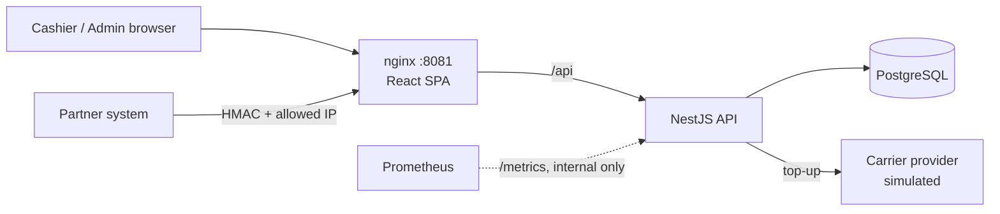
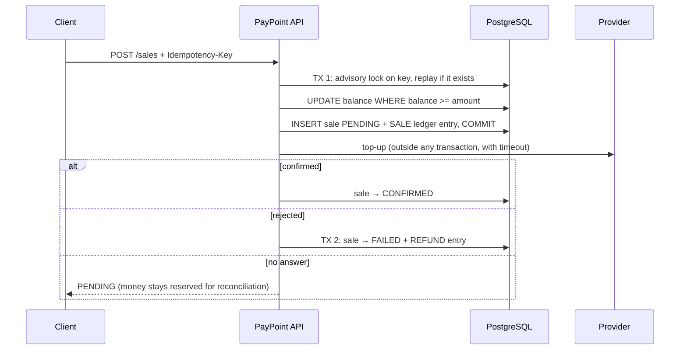

# AtomicTrail — Transaction Reliability Lab

*Formerly the PayPoint repository.*

[](https://github.com/vzuliani97/atomictrail/actions/workflows/ci.yml)
[](https://github.com/vzuliani97/atomictrail/actions/workflows/codeql.yml)

A reliability lab for a transactional API: safe state transitions in PostgreSQL ("atomic") and an auditable record of every balance movement ("trail"). The sample service inside it is **PayPoint**, a prepaid top-up and payments platform for a network of points of sale. Each store holds a prepaid balance and sells mobile top-ups and gift cards, either from a web portal or from a partner's own system through a signed B2B API. The service's code, images and metrics keep the `paypoint` name.

The interesting part is not the CRUD. It is keeping money correct when requests race, retry or fail halfway.

| Problem | How PayPoint handles it | Proof |
|---|---|---|
| Two sales spend the same balance at once | Check and debit in one conditional `UPDATE`, plus `CHECK (balance >= 0)` | 70 concurrent sales against room for 50 approve exactly 50 ([local experiment](docs/concurrency-experiment.md), not a production benchmark) |
| A network retry charges twice | Mandatory `Idempotency-Key`, `UNIQUE (pos_id, key)`, a per-key advisory lock and a request hash | 70 concurrent retries create 1 sale; same key with a different body returns 409 |
| The balance can't be explained | Append-only ledger; tests check that the balance equals the sum of movements | Every balance test |
| The carrier rejects the top-up | Automatic refund, at most once per sale (enforced by a partial unique index) | Refund test |
| The carrier times out (outcome unknown) | Sale stays `PENDING` with the money reserved; never refunded blindly | Timeout test with a provider that never answers |
| Only authorized partners may sell | HMAC-SHA256 signature over timestamp, method, path and body hash; 5-minute window; IP allowlist with CIDR | Tampered body, stale timestamp, unknown key and wrong IP are all rejected |


## Stack

- **Backend:** NestJS 11, TypeScript, PostgreSQL 16 (plain SQL with the `pg` driver, versioned migrations), Zod, JWT, bcrypt, Helmet, Prometheus metrics
- **Frontend:** React 19 + TypeScript (Vite), served by unprivileged nginx
- **Quality:** Jest + Supertest, 37 tests (10 unit, 27 integration against a real PostgreSQL), CodeQL, Gitleaks, `npm audit`, Dependabot
- **Delivery:** multi-stage Docker images running as non-root, Docker Compose, GitHub Actions publishing to GHCR. Deployed to Kubernetes in [OpsCircuit](https://github.com/vzuliani97/opscircuit).

## Architecture



### Sale flow



The provider is called **outside** the transaction. Holding the balance row lock during a network call would queue every other sale of that store behind it.

## Run it

```bash
cp .env.example .env     # then change the values
make up                  # or: docker compose up --build
```

- App: http://localhost:8081. Demo users `cajero@paypoint.local` and `admin@paypoint.local`, password from `DEMO_PASSWORD`. All data is synthetic.
- Partner demo: `make partner-demo` sends signed requests (balance, sale, balance).

## Tests

```bash
make test        # whole suite in containers, against a disposable PostgreSQL
```

Highlights: 70-way concurrency on balance and idempotency, refunds exactly once, timeout leaves the sale `PENDING`, every HMAC failure mode, role and tenant isolation (a cashier never sees another store), metrics exported from startup.

## Design decisions and trade-offs

| Decision | Why | Trade-off |
|---|---|---|
| Plain SQL instead of an ORM | The critical paths (conditional updates, advisory locks, partial unique indexes) are explicit and reviewable | Manual row mapping |
| Integers in COP, no floats | Money must be exact | Other currencies would need minor units and `BIGINT` |
| Ledger plus stored balance | O(1) balance reads, and every peso remains explainable | Two writes per movement, always in one transaction |
| `PENDING` on timeout instead of refund | A timeout doesn't mean the top-up failed; refunding could give the product away | Needs a reconciliation job (see limitations) |
| HMAC on the body hash, compared in constant time | Integrity and authenticity without sending the secret; no timing side channel | Clocks must be within 5 minutes |
| Migrations at startup, guarded by an advisory lock | Simple for a small service; safe with several replicas | A dedicated migration job scales better in large deployments |

## Security

- bcrypt passwords. Login gives the same answer, in the same time, for an unknown email and a wrong password.
- JWT pinned to HS256; role checks on every route; the store id comes from the token, never from the request.
- Strict Zod validation (unknown fields rejected), 10 KB body limit, Helmet headers, CORS restricted.
- nginx overwrites `X-Forwarded-For` and the API trusts exactly one proxy hop, so clients can't spoof their IP into the allowlist. nginx also fails fast (504 after 3 s) when the API is down.
- `/metrics` is internal only, because nginx routes just `/api` and `/health`.
- CI: Gitleaks over the full git history, `npm audit --omit=dev --audit-level=high`, CodeQL, actions pinned to commit SHAs, least-privilege `GITHUB_TOKEN`.

## Known limitations

- **Reconciliation of `PENDING` sales** is not implemented yet (a job that asks the provider and confirms or refunds).
- HMAC secrets are stored in plain text in the database. Production would use KMS or Secrets Manager.
- Admin balance credits are not idempotent yet.
- No login rate limiting or refresh tokens.
- The provider is simulated, so there are no real carrier integrations.

## Design walkthrough

[DESIGN_WALKTHROUGH.md](DESIGN_WALKTHROUGH.md) has a 90-second demo script and the hard questions this design invites, with answers that point to code and tests.

## License and provenance

MIT.

Independent portfolio reconstruction based on engineering patterns from professional work. It uses synthetic data and contains no employer code or confidential information. AI-assisted development tools were used; the implementation was reviewed and verified through tests and CI.
