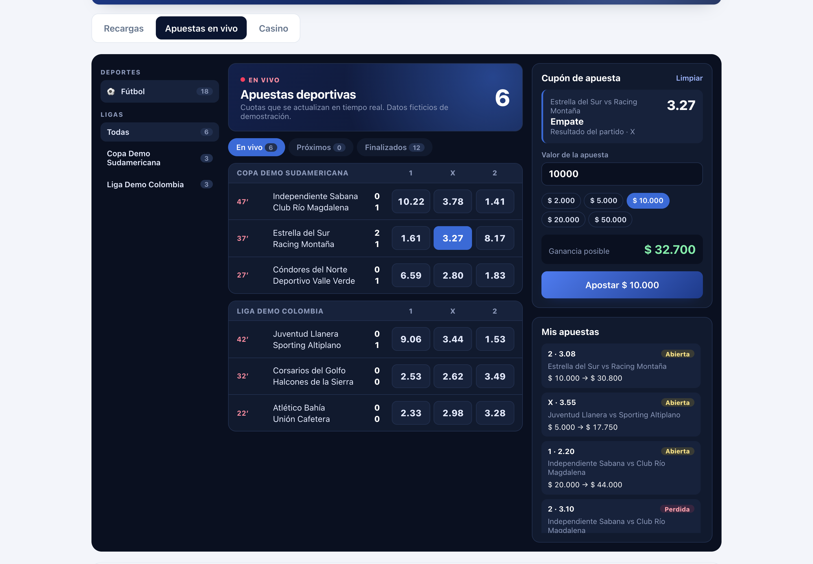
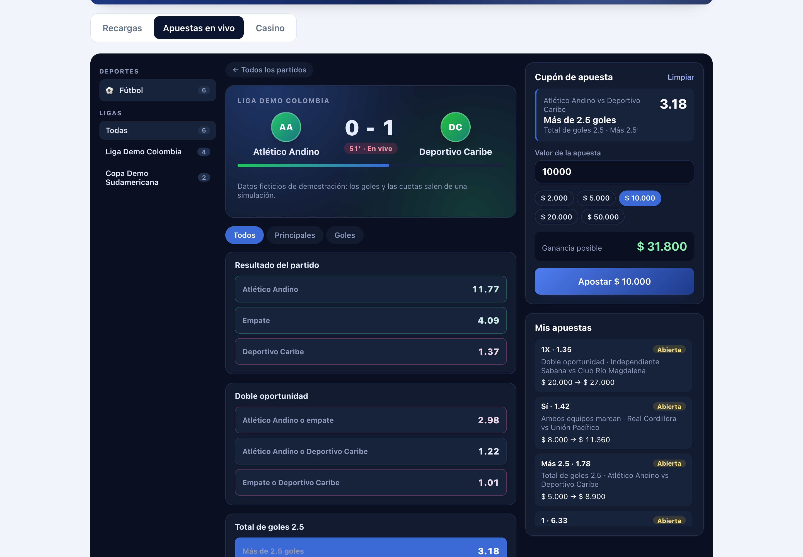
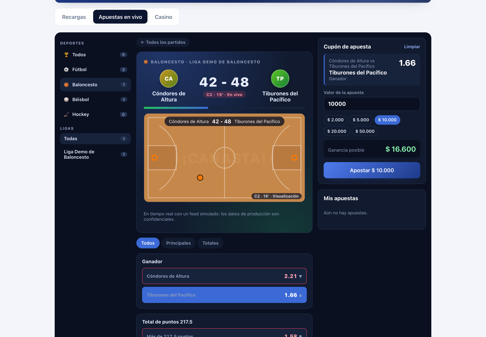
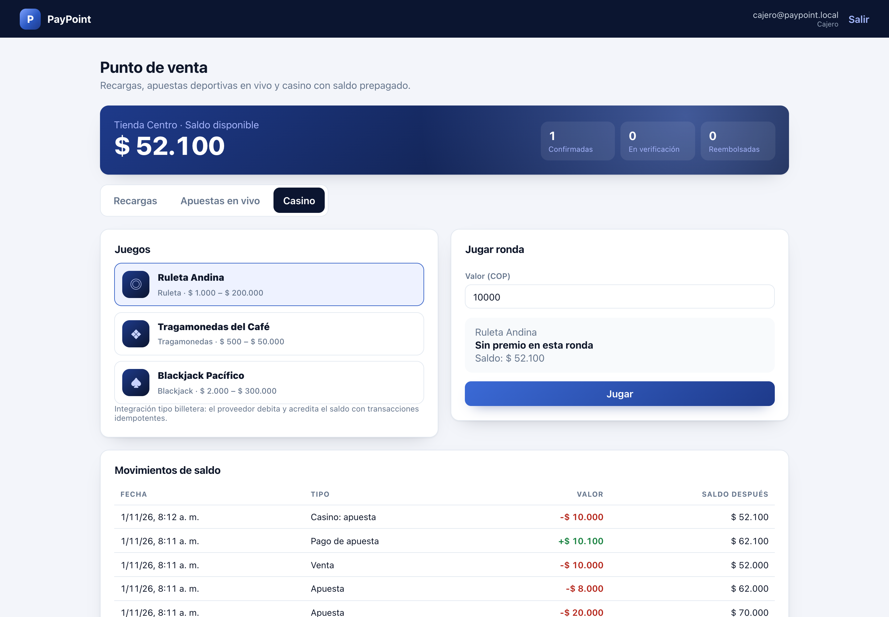
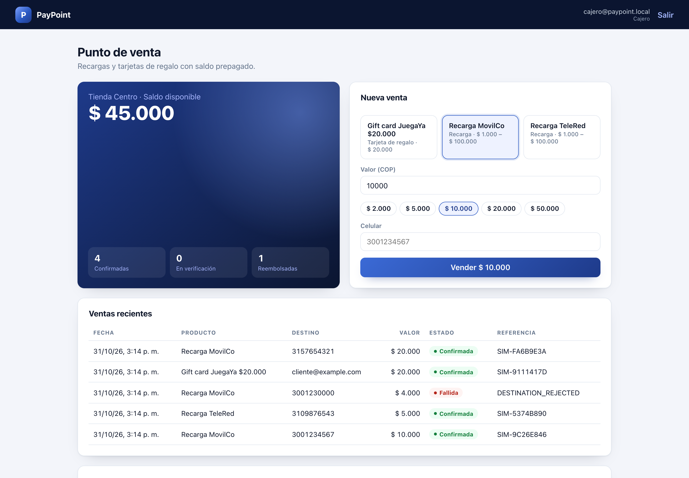
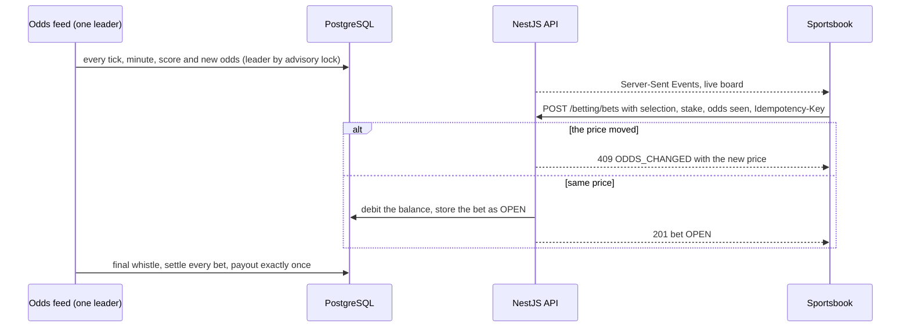
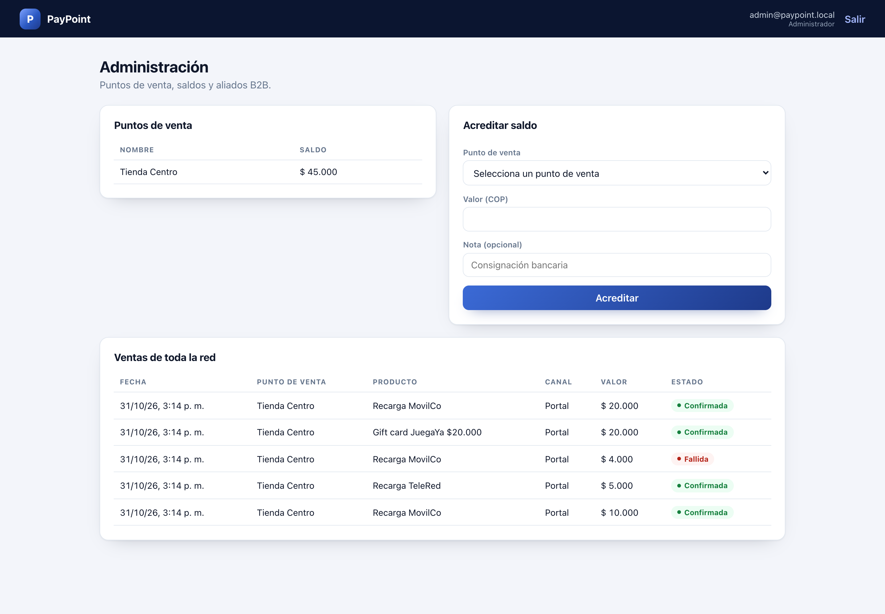
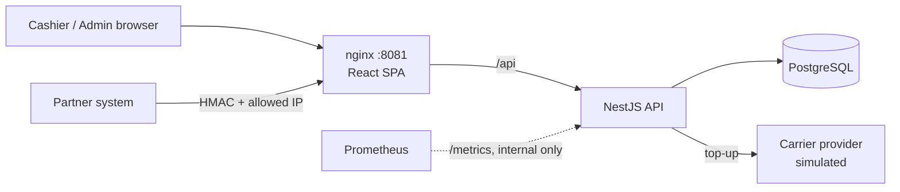
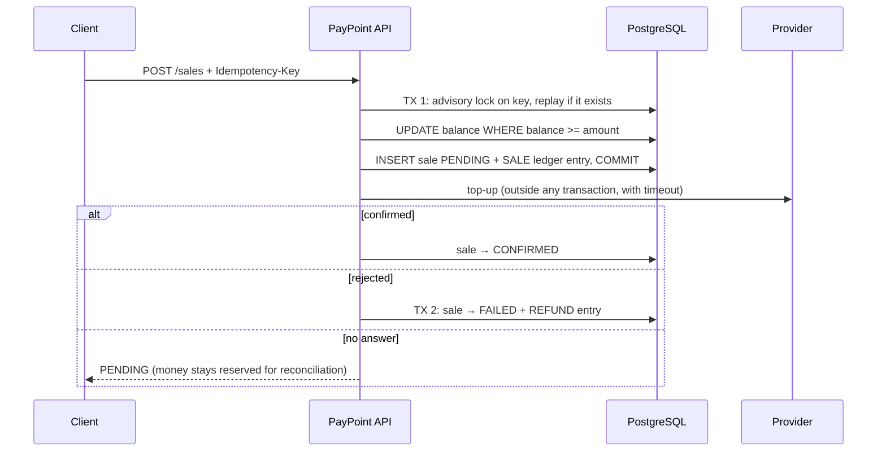

# NekoBet — Live Sportsbook, Casino & Wallet Platform

*Formerly AtomicTrail, and before that the PayPoint repository.*

[](https://github.com/vzuliani97/nekobet/actions/workflows/ci.yml)
[](https://github.com/vzuliani97/nekobet/actions/workflows/codeql.yml)

A point-of-sale platform where every store sells live sports bets, casino games and prepaid top-ups from one balance: a real-time sportsbook for football, basketball, baseball and ice hockey with several markets per event, a casino lobby with slot machines and table games, and a cashier for top-ups. Built in TypeScript and PostgreSQL as a transaction reliability lab: the balance stays correct under concurrent requests, retries, provider timeouts and reversals, with idempotency, an append-only ledger, HMAC-signed integrations and real-time events.

Everything runs in real time. The production betting platforms I worked on, their providers and their data are confidential, so this public version runs on a simulated feed of fictitious events, odds and games. NekoBet is a demonstration, not a licensed betting service. The service's code, images and metrics keep the `paypoint` name.



| Football event: live tracker and markets | Basketball: court tracker by quarter | Casino lobby and slot machine |
|---|---|---|
|  |  |  |

The interesting part is not the screens. It is keeping money correct when requests race, retry or fail halfway.

## What it is for

A network of stores sells prepaid top-ups, live sports bets and casino play from one prepaid balance per store. Cashiers use a web portal; partner systems use a signed B2B API; providers (carrier, odds feed, game provider) answer late or not at all. The balance must stay right through all of it.

| Who | What they do here |
|---|---|
| Cashier | Sells top-ups, places live bets from the sportsbook (odds move in real time), opens casino games paid from the same balance, and sees every balance movement |
| Admin | Creates points of sale, credits balances, watches network sales |
| Partner system | Sells through the HMAC-signed API with its own idempotency keys |

## What I built

Everything in this repository, end to end:

- **Data model:** balances guarded by `CHECK (balance >= 0)`, an append-only ledger, sales, bets, settlements and casino wallet transactions, in plain versioned SQL.
- **API (NestJS):** idempotent sales with a per-key advisory lock and request hash, the provider call outside the transaction, refunds at most once, an HMAC-SHA256 partner API with an IP allowlist, JWT roles and Zod validation.
- **Live betting:** a simulated odds feed with a single leader (`pg_try_advisory_xact_lock`) for four sports, each with its own clock and scoring model: football and ice hockey (Poisson goals, three-way result, double chance, total goals, both teams to score), basketball (quarters and overtime, a normal model of points, winner and total points) and baseball (innings and extra innings, Poisson runs, winner and total runs), Server-Sent Events to the browser, `ODDS_CHANGED` when the price moved, and settlement of every market paid exactly once.
- **Casino:** a seamless wallet whose provider callbacks are idempotent by transaction id, with rollback tombstones; five fictitious games, three of them slot machines whose reels show the outcome the provider decided.
- **Frontend (React):** the cashier with top-ups; the sportsbook with sports and leagues, each sport's clock and score, an event page with a live tracker drawn for each sport (pitch, court, diamond or rink) and every market, bet slip and my bets; the casino lobby with an animated slot machine; the admin screens.
- **Delivery and quality:** Docker Compose, Prometheus metrics, multi-arch images published by CI and deployed by Argo CD in [OpsCircuit](https://github.com/vzuliani97/opscircuit), 54 automated tests, CodeQL, Gitleaks and `npm audit`.

| Problem | How NekoBet handles it | Proof |
|---|---|---|
| Two sales spend the same balance at once | Check and debit in one conditional `UPDATE`, plus `CHECK (balance >= 0)` | 70 concurrent sales against room for 50 approve exactly 50 ([local experiment](docs/concurrency-experiment.md), not a production benchmark) |
| A network retry charges twice | Mandatory `Idempotency-Key`, `UNIQUE (pos_id, key)`, a per-key advisory lock and a request hash | 70 concurrent retries create 1 sale; same key with a different body returns 409 |
| The balance can't be explained | Append-only ledger; tests check that the balance equals the sum of movements | Every balance test |
| The carrier rejects the top-up | Automatic refund, at most once per sale (enforced by a partial unique index) | Refund test |
| The carrier times out (outcome unknown) | Sale stays `PENDING` with the money reserved; never refunded blindly | Timeout test with a provider that never answers |
| Live odds move while the cashier decides | The bet carries the odds the cashier saw; if the price moved, the bet is refused with `ODDS_CHANGED` and no money moves | Odds-changed test |
| A match ends and winners must be paid | Settlement updates only `OPEN` bets and a unique index allows one payout per bet | Settling twice pays once |
| A casino provider retries or reverses a wallet call | Seamless wallet keyed by the provider's transaction id; a rollback that arrives before its debit leaves a tombstone | Retried debit applied once; late debit refused |
| Only authorized partners may sell | HMAC-SHA256 signature over timestamp, method, path and body hash; 5-minute window; IP allowlist with CIDR | Tampered body, stale timestamp, unknown key and wrong IP are all rejected |



## Processes, step by step

### 1. Sell a top-up

1. The cashier picks a product and the amount; the request carries an `Idempotency-Key`.
2. One conditional `UPDATE` checks and debits the balance, and the sale is committed as `PENDING` with the money reserved.
3. The carrier is called **outside** the transaction. Approved: `CONFIRMED`. Rejected: refunded at most once. No answer: it stays `PENDING`, never refunded blindly (see the [sale flow](#sale-flow)).


### 2. Place a live bet



1. The board shows live events by sport and league with each sport's clock (minute, quarter or inning), the score and the result odds moving up or down; "+N" opens the event page with every market. Football and hockey have match result, double chance, total goals and both teams to score; basketball and baseball have winner and total points or runs. Totals are priced over the time left and suspended once the score decides them; basketball and baseball play overtime or extra innings until someone leads. The event page draws a live tracker for each sport: score, clock and the scoring flash come from the feed, and the moving ball is an animation labeled as such, because the simulated feed has no play-by-play positions.
2. A tap on a price fills the bet slip; the bet carries the odds the cashier saw. If the price moved, the API refuses with `ODDS_CHANGED` and the slip offers the new one.
3. At the final whistle every market is settled from the final score; a unique index guarantees one payout per bet.


### 3. Play the casino (seamless wallet)

1. The game provider calls the wallet to debit a bet, credit a win or roll back, signing each callback with HMAC.
2. Every callback is idempotent by the provider's transaction id: a retry gets the same answer and moves no money twice.
3. A rollback that arrives before its debit leaves a tombstone, so the late debit is refused.
4. The lobby has five fictitious games. In a slot machine the reels spin and stop one by one on the outcome the provider already decided and paid through the wallet.


### 4. Partner API (B2B)

Partners sign timestamp, method, path and body hash with HMAC-SHA256; the server checks it in constant time within a 5-minute window and against an IP allowlist, then runs the same idempotent sale.

### 5. Administer the network

The admin creates points of sale, credits their balances and watches sales across the network.



## Stack

| Layer | Technologies |
|---|---|
| Frontend | React 19, TypeScript, Vite 8, EventSource for Server-Sent Events, SVG live tracker; served by unprivileged nginx 1.30 with a strict Content-Security-Policy |
| Backend | Node.js 24, NestJS 11, Zod 4, JWT, bcrypt, Helmet, HMAC-SHA256, Server-Sent Events |
| Data | PostgreSQL 16 (plain SQL with the `pg` driver, versioned migrations, advisory locks, append-only ledger) |
| Infrastructure and DevOps | Docker multi-stage images running as non-root, Docker Compose, multi-arch images on GHCR, deployed to Kubernetes by Argo CD in [OpsCircuit](https://github.com/vzuliani97/opscircuit) |
| CI/CD and quality | GitHub Actions (actions pinned by SHA), Jest + Supertest: 54 tests (14 unit, 40 integration against a real PostgreSQL), Dependabot |
| Security | CodeQL, Gitleaks, `npm audit`, Trivy image scan, OWASP ZAP baseline (DAST), SBOM and SLSA provenance, cosign keyless signing, an image-metadata check, login lockout, IP allowlist |
| Observability | Prometheus metrics (`prom-client`), scraped by OpsCircuit |

## Architecture



### Sale flow



The provider is called **outside** the transaction. Holding the balance row lock during a network call would queue every other sale of that store behind it.

## Run it

```bash
cp .env.example .env     # then change the values
make up                  # or: docker compose up --build
```

- App: http://localhost:8081. Demo users `cajero@paypoint.local` and `admin@paypoint.local`, password from `DEMO_PASSWORD`. All data is synthetic.
- Partner demo: `make partner-demo` sends signed requests (balance, sale, balance).

## Tests

```bash
make test        # whole suite in containers, against a disposable PostgreSQL
```

Highlights: 70-way concurrency on balance and idempotency, refunds exactly once, timeout leaves the sale `PENDING`, every HMAC failure mode, role and tenant isolation (a cashier never sees another store), metrics exported from startup. Betting and casino: odds-changed refusal with no money moved, ten racing bets accepted only up to the balance, settlement paid once, a feed tick that ends and settles a match, the SSE stream, signed wallet callbacks applied once, and a rollback that overtakes its debit.

## Design decisions and trade-offs

| Decision | Why | Trade-off |
|---|---|---|
| Plain SQL instead of an ORM | The critical paths (conditional updates, advisory locks, partial unique indexes) are explicit and reviewable | Manual row mapping |
| Integers in COP, no floats | Money must be exact | Other currencies would need minor units and `BIGINT` |
| Ledger plus stored balance | O(1) balance reads, and every peso remains explainable | Two writes per movement, always in one transaction |
| `PENDING` on timeout instead of refund | A timeout doesn't mean the top-up failed; refunding could give the product away | Needs a reconciliation job (see limitations) |
| HMAC on the body hash, compared in constant time | Integrity and authenticity without sending the secret; no timing side channel | Clocks must be within 5 minutes |
| Migrations at startup, guarded by an advisory lock | Simple for a small service; safe with several replicas | A dedicated migration job scales better in large deployments |

## Security

- bcrypt passwords. Login gives the same answer, in the same time, for an unknown email and a wrong password.
- After 5 failed logins for one email from one address, that pair is locked for 15 minutes (`429 TOO_MANY_ATTEMPTS`), even for the right password. The counter lives in memory, so each API replica counts on its own.
- The demo casino and partner secrets are published in this repository, so the API refuses to start with them in production unless it runs in demo mode.
- JWT pinned to HS256; role checks on every route; the store id comes from the token, never from the request.
- Strict Zod validation (unknown fields rejected), 10 KB body limit, Helmet headers, CORS restricted.
- nginx overwrites `X-Forwarded-For` and the API trusts exactly one proxy hop, so clients can't spoof their IP into the allowlist. nginx also fails fast (504 after 3 s) when the API is down.
- `/metrics` is internal only, because nginx routes just `/api` and `/health`.
- nginx serves the app with a strict Content-Security-Policy (`default-src 'self'`, no plugins, no framing), `nosniff`, `Referrer-Policy: no-referrer`, a Permissions-Policy and COOP/CORP, and does not reveal its version.
- The runtime images carry no package manager: npm, npx, corepack and yarn are removed from the API image, and Alpine security fixes are applied to the nginx image at build time.
- CI: Gitleaks over the full git history, `npm audit --omit=dev --audit-level=high` and CodeQL. Trivy fails the build on any fixable critical or high CVE in the images, and an OWASP ZAP baseline scan of the running stack fails it on any warning not accepted, with its reason, in [`.zap/rules.tsv`](.zap/rules.tsv). Actions are pinned to commit SHAs, scanner images to digests, and `GITHUB_TOKEN` is least-privilege.
- Published images carry an SBOM and SLSA build provenance, and are signed with cosign keyless (Sigstore), so a cluster can refuse anything this workflow did not build. To verify one:

```bash
cosign verify ghcr.io/vzuliani97/paypoint-backend:main \
  --certificate-identity https://github.com/vzuliani97/nekobet/.github/workflows/ci.yml@refs/heads/main \
  --certificate-oidc-issuer https://token.actions.githubusercontent.com
```

## Known limitations

- **Betting and casino are a demonstration.** The production platforms and their data are confidential, so teams, leagues and games here are fictitious and the odds feed and game provider are simulated, running in real time. Real online betting in Colombia requires a Coljuegos license, and there are no responsible-gaming limits, player accounts or KYC here: the "wallet" is the store's prepaid balance.

- **Reconciliation of `PENDING` sales** is not implemented yet (a job that asks the provider and confirms or refunds).
- HMAC secrets are stored in plain text in the database. Production would use KMS or Secrets Manager.
- Admin balance credits are not idempotent yet.
- No login rate limiting or refresh tokens.
- The provider is simulated, so there are no real carrier integrations.

## Design walkthrough

[DESIGN_WALKTHROUGH.md](DESIGN_WALKTHROUGH.md) has a 90-second demo script and the hard questions this design invites, with answers that point to code and tests.

## License and provenance

MIT.

Independent portfolio reconstruction based on engineering patterns from professional work. It uses synthetic data and contains no employer code or confidential information.
